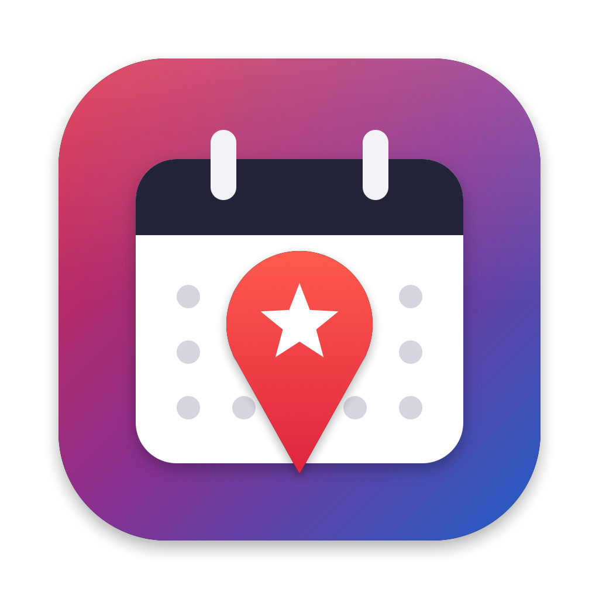

# Event Monitor



Eine schlanke, quelloffene macOS-App, die Veranstaltungen in **Mainz**, **Wiesbaden** und **Frankfurt** an einem Ort
zeigt – Konzerte, Flohmärkte, Theater, Demos, Vorträge, Ausstellungen, Geschichte und mehr.

## Funktionen

- **Beide Städte in einer Liste**, nach Tagen gruppiert („Heute“, „Morgen“, …)
- **Filter** nach Stadt, Zeitraum (Heute, Morgen, Wochenende, 7 oder 14 Tage) und Kategorie
- **Meine Interessen**: eigene Lieblingskategorien gesammelt in der Seitenleiste
- **Preise**: „Kostenlos“, „12 €“ oder „8–15 €“ direkt in der Liste – aus dem Beschreibungstext oder
  (bei den Stadtkalendern) von der Detailseite nachgeladen, sobald ein Termin sichtbar ist
- **Suche** über Titel, Ort und Beschreibung
- **Ausschließen** per Rechtsklick oder Knopf in der Detailansicht:
  - eine Veranstaltung mit allen ihren Terminen (z. B. ein wöchentlicher Kurs)
  - alles an einem bestimmten Ort
  - eine ganze Kategorie
  - alles mit einem Stichwort im Titel oder Ort

  Ausschlüsse greifen sofort und bei allen künftigen Scans. Verwaltet werden sie unter
  *Einstellungen → Ausschlüsse* (⌘,). Direkt nach einem Ausschluss gibt es „Rückgängig“.
- **In Kalender übernehmen** als `.ics`-Datei (funktioniert mit jeder Kalender-App)
- **Karte** über OpenStreetMap
- **Eigene Quellen**: iCal-Feeds (`.ics`/`webcal://`) oder Webseiten mit schema.org-Veranstaltungsdaten

## Datenquellen

| Quelle | Weg |
| --- | --- |
| Veranstaltungskalender der Landeshauptstadt Mainz (mainz.de) | öffentliche Such-Schnittstelle der Website (`/api/graphql/`) |
| Veranstaltungskalender der Landeshauptstadt Wiesbaden (wiesbaden.de) | dieselbe Schnittstelle (beide Städte nutzen das gleiche CMS) |
| Haus Mainusch, Haus des Erinnerns, Kulturbäckerei (Mainz), Kreativfabrik (Wiesbaden) | iCalendar (RFC 5545) |
| ZOOM (Frankfurt) | schema.org-Daten (JSON-LD) auf der Website |
| Eigene Kalender | iCalendar oder schema.org |

Für Frankfurt gibt es keinen offenen städtischen Kalender (frankfurt.de ist zudem gegen automatische Abrufe
geschützt); die Stadt ist daher vor allem über einzelne Orte und eigene Quellen abgedeckt. Öffentliche Listen
angemeldeter Demonstrationen veröffentlichen die drei Städte nicht – Demos erscheinen, wenn eine Quelle sie
ankündigt, und werden dann der Kategorie „Demos & Kundgebungen“ zugeordnet.

Die App fragt genau die Daten ab, die die Websites selbst im Browser laden, und verlinkt immer auf die
Originalseite. Die Schnittstelle ist nicht offiziell dokumentiert und kann sich ändern – dann muss
[`SiteparkEventSource.swift`](Sources/EventMonitorCore/Sources/SiteparkEventSource.swift) angepasst werden.
Alle Angaben ohne Gewähr; die Rechte an den Inhalten liegen bei den Städten bzw. Veranstaltern.

## Bauen und starten

Voraussetzungen: macOS 14 oder neuer und die Swift-Toolchain (Xcode oder Command Line Tools).

```bash
# direkt starten (zum Entwickeln)
swift run

# Tests
swift test

# Tests gegen die echten Stadtkalender
EVENTMONITOR_LIVE=1 swift test --filter LiveTests

# richtige App bauen → build/EventMonitor.app
./scripts/build-app.sh
open build/EventMonitor.app
```

Ein Xcode-Projekt ist nicht nötig; `Package.swift` lässt sich aber auch direkt in Xcode öffnen.

## Aufbau

```
Sources/
  EventMonitorCore/          Logik ohne Oberfläche (gut testbar)
    Models/                  Event, Kategorien, Ausschlussregeln, Einstellungen
    Sources/                 Datenquellen: Stadtkalender (GraphQL), iCal lesen/schreiben
    Scanner.swift            fragt alle Quellen parallel ab, filtert, speichert als JSON
  EventMonitor/              SwiftUI-App
    AppModel.swift           Zustand der App, Filter, Aktionen
    Views/                   Liste, Detailansicht, Einstellungen
Tests/EventMonitorCoreTests/ Swift-Testing-Tests
Resources/                   App-Logo (.icns und .png)
scripts/build-app.sh         erzeugt das .app-Bundle
scripts/make-icon.swift      zeichnet das Logo per Code
```

Einstellungen, Ausschlüsse und der letzte Scan liegen als lesbare JSON-Dateien in
`~/Library/Application Support/EventMonitor/`.

## Lizenz

[MIT](LICENSE) – frei nutzbar, veränderbar und weitergebbar.
Keine Tracker, keine Konten, keine Abhängigkeiten außer der Swift-Standardbibliothek und den macOS-Frameworks.
